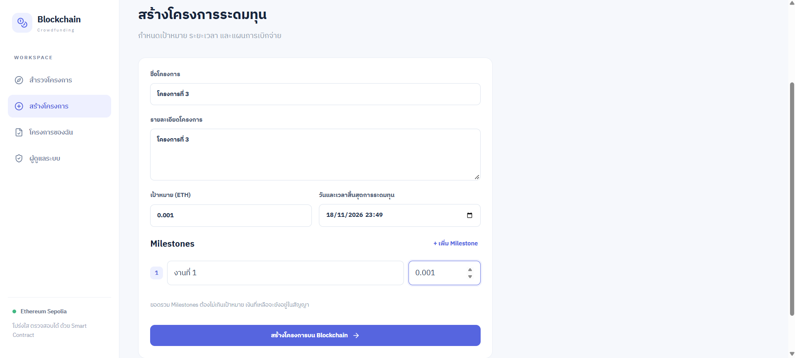
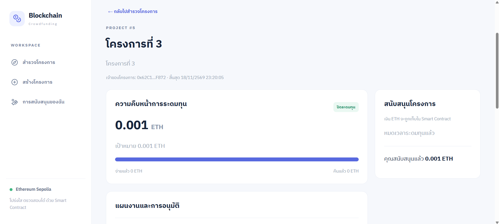
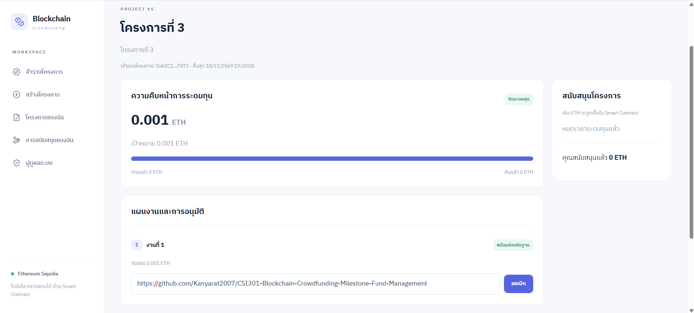
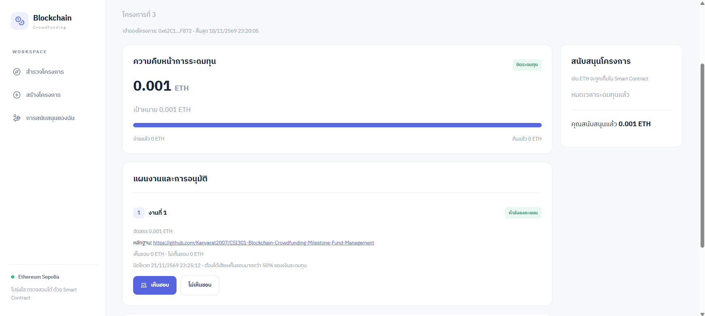
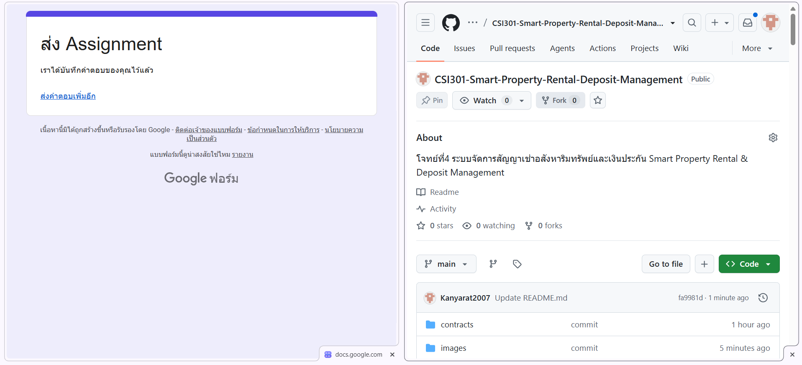
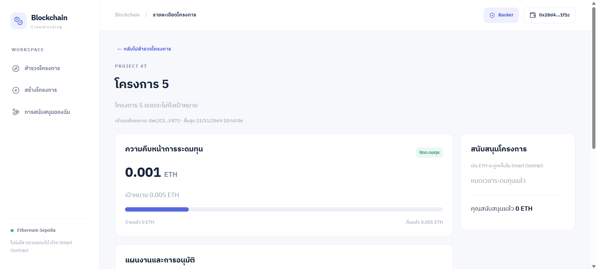

# InnovateFund — Blockchain Crowdfunding & Milestone Fund Management

ระบบระดมทุน Ethereum แบบ Escrow: เงิน ETH ของผู้สนับสนุนถูกเก็บใน Smart Contract และจ่ายให้เจ้าของโครงการได้เมื่อ Milestone ผ่านการโหวตตามเงื่อนไขเท่านั้น

## Role และสิทธิ์

| Role    | เมนู                                                  | สิทธิ์                                                            |
| ------- | ----------------------------------------------------- | ----------------------------------------------------------------- |
| Guest   | สำรวจโครงการ, ภาพรวม                                  | ดูข้อมูลสาธารณะ, เชื่อมต่อ MetaMask                               |
| Creator | สร้างโครงการ, โครงการของฉัน, สำรวจโครงการ, ภาพรวม     | สร้าง Campaign, ส่งหลักฐาน, ขอเบิกเงินเมื่อเข้าเงื่อนไข           |
| Backer  | การสนับสนุนของฉัน, สำรวจโครงการ, ภาพรวม, สร้างโครงการ | สนับสนุน ETH, ลงคะแนนตามสัดส่วน ETH, ขอคืนเงินถ้าระดมทุนไม่สำเร็จ |
| Admin   | ผู้ดูแลระบบ, สำรวจโครงการ, ภาพรวม และเมนูตามกิจกรรม   | ตรวจสอบโครงการทั้งหมด; ไม่มีสิทธิ์ถอนเงินผู้อื่น                  |

## กฎธุรกิจที่ใช้ในเวอร์ชันนี้

1. เจ้าของสร้าง Campaign โดยระบุชื่อ คำอธิบาย เป้าหมาย ETH ระยะเวลา และ Milestone (สูงสุด 20 รายการ)
2. ยอดรวมที่จัดสรรให้ Milestones ต้องไม่เกินเป้าหมายการระดมทุน
3. Backer ส่ง ETH ก่อน deadline; เงินคงอยู่ใน Contract
4. หลัง deadline หากยอดรวมถึงเป้าหมาย Creator จึงขอเบิก Milestone แรกได้ โดยส่งข้อความ/URL หลักฐาน
5. แต่ละ Milestone เปิดโหวต **3 วัน**; น้ำหนักคะแนนเท่ากับยอด ETH ที่สนับสนุน ผู้สนับสนุนหนึ่ง Wallet โหวตได้ครั้งเดียวต่อ Milestone
6. เมื่อครบ 3 วัน ต้องมีคะแนนเห็นชอบ **มากกว่า 50% ของยอดเงินระดมทุนทั้งหมด** จึงให้ใครก็ได้เรียก `release()` เพื่อจ่ายให้ Creator (ไม่จ่ายอัตโนมัติด้วยตัวเอง)
7. Milestone ถัดไปต้องรอให้ Milestone ก่อนหน้าจ่ายสำเร็จ
8. หาก deadline ผ่านและยอดระดมทุนไม่ถึงเป้า Backer เรียก `refund()` รับ ETH ที่ตนสนับสนุนกลับ (แบบ pull refund)
9. Contract ตรวจยอดคงเหลือก่อนจ่าย และป้องกันการเรียกซ้ำ

## วิธีรัน

```bash
npm install
npm run dev
```

## 3. ขั้นตอนทดสอบครบวงจร

1. Wallet A เชื่อมต่อและสร้างโครงการ เป้าหมาย `0.001 ETH` ระยะเวลา 1 วัน Milestone 1=`0.001 ETH`
   

2. Wallet B ส่ง `0.02 ETH` เข้า Campaign
   

3. รอ deadline

4. Wallet A ส่งหลักฐาน Milestone 1 เช่น URL GitHub/Google Drive ที่เปิดอ่านได้
   

5. Wallet B โหวตเห็นชอบ
   

6. หลัง 3 วัน เรียก `release()` (ใครก็เรียกได้) และตรวจเงินเข้ากระเป๋า Creator
   

7. ทดสอบ Refund ด้วยอีก Campaign ที่ยอดไม่ถึงเป้าหมายเมื่อหมดเวลา
   
